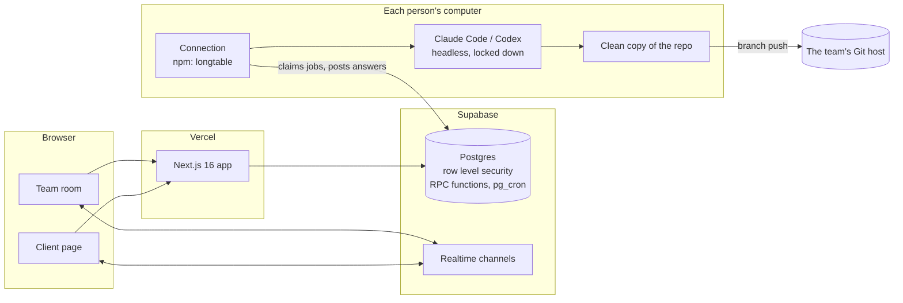

# Longtable

**One live room where a small software team, the AIs each of them brings, and their client work together.**

[longtable.chat](https://longtable.chat) · [Try the demo](https://longtable.chat/demo) · MIT licensed

> **Status: early.** Live at longtable.chat and used by a real team. The background connection is at v0.1.x
> (npm package `longtable`) and updates itself. Expect rough edges, and please open an issue when you find one.


## What it does

- **The team** talks in chats. Anyone can ask the table, and the AIs that are connected each give a view; one writes a
  single answer, with the files it read and how the views were settled. Ask for a change and the AIs make it on a
  branch of its own, look over each other's work, and say what to check.
- **Each person's own AI** sits at the table on that person's own plan: Claude Code or Codex, running on their own
  computer. Nobody hands over an API key, and nobody types a command to connect.
- **Decisions** are cards with options. Pick one and you see the exact words the client would be told; change them if
  you like, then send.
- **The client** gets a page of their own: they ask in their own words and are always answered, by the team's
  assistant or their own AI. They never see the team's side, and the database enforces that, not just the page.
- **Handouts**: plans, mockups and charts the AIs make for the team, with versions, comments and live cursors.

## How it fits together



- **The browser** talks to Postgres through Supabase with the person's own session. Every table has row level security,
  and every change goes through a function that checks who is asking. Live updates arrive on private channels.
- **The connection** (`packages/connect`) is a small Node program on each person's computer. It holds a revocable device
  token, claims jobs for its seat from a queue in Postgres, and runs that person's Claude Code or Codex headless: read
  and search only, or file edits confined to a work folder with no `.git` in it. It never runs commands. Changes land
  as one commit on a `longtable/...` branch, never the default branch.
- **Longtable never stores code** or anyone's AI sign-in. Anything shaped like a key is hidden before an answer is saved.

## How it's tested

Testing is the part of this project with the most care in it.

- **CI on every push** (`.github/workflows/checks.yml`): type checks, the house rules, and the unit suites on Ubuntu
  (Node 20 and 22), macOS and Windows. A separate job proves the connection starts with the computer on a real Mac
  (launchd) and real Linux (systemd), restarts after an update, and is removed cleanly.
- **Chaos tests**: `chaos-connect` throws hundreds of thousands of random inputs at the connection on every push and
  checks around sixty "always true" rules after each step; `chaos-db` plays random sequences against the database with
  two people acting at once and time jumping ahead.
- **A weekly database suite** (`database.yml`) starts a fresh Supabase inside the job and runs every browser and
  database suite: the client wall, one table never reading another, invites, decisions, handouts, the access sweep.
- **Real-model suites** run the connection against real Claude Code and Codex: answers with sources, work on a branch,
  hand-offs between two AIs, planted instructions that must change nothing, and keys that must never reach the room.
- **[THREAT-MODEL.md](THREAT-MODEL.md)** lists each threat, the control, and the test that proves it.
- Commits are scanned for anything shaped like a key before they are made.

## Running it yourself

You need Node 22, Docker, and Chrome for the browser tests.

```bash
npm install
npm run db:start
npm run dev
```

The app is at http://localhost:3000, and sign-in codes arrive in the local mail catcher at http://127.0.0.1:54324.
Copy `apps/web/.env.example` to `apps/web/.env.local` and fill it from `npx supabase status`.

- `node tests/e2e/<suite>.mjs` runs one suite; the unit suites need no database and no AI.
- The real-model suites need Claude Code (or Codex) signed in on the computer.
- To be the operator of your own Longtable, add your email in SQL:
  `insert into public.operators (email) values ('you@example.com');`

## Repository

| Path | What is there |
| --- | --- |
| `apps/web` | The Next.js app: the room, the client page, settings, the opening page and demo |
| `packages/connect` | The background connection, published to npm as `longtable` |
| `supabase/migrations` | The schema, row level security and every server function |
| `tests/e2e` | Browser, database, chaos and real-model suites |
| `tests/evals` | Behaviour checks on the AIs themselves (pytest) |

## License

MIT. See [LICENSE](LICENSE).
